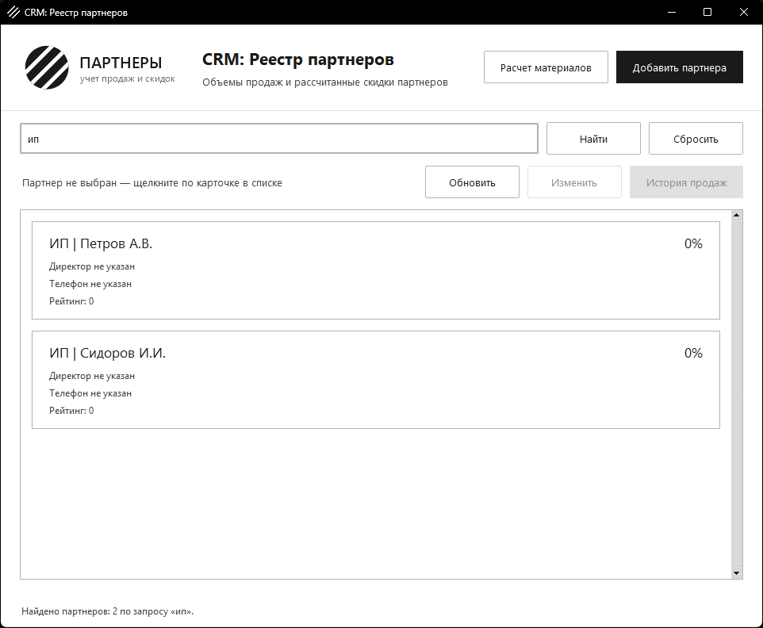
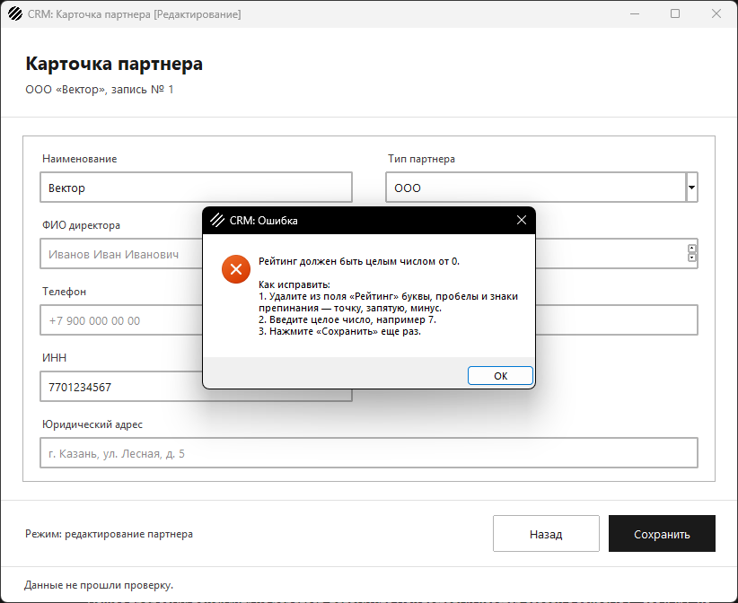
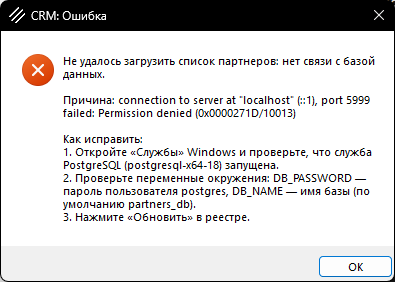
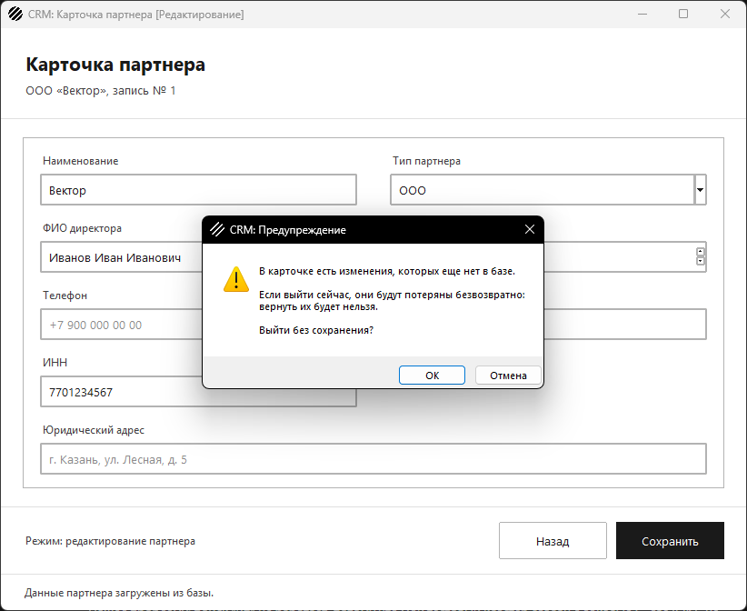

# Автоматизированное тестирование, аудит безопасности и UX

Финальный этап перед сдачей: приложение должно пройти стресс-тесты,
проверку безопасности и быть готовым к непредвиденным действиям
пользователя.

Проверки шли не только на заглушках: приложение и тесты прогнаны на
настоящей базе PostgreSQL 18.4, собранной из `schema.sql` и `import.sql`
этой папки с данными заказчика. Две ошибки нашлись только так — они
описаны ниже.

## 1. Модульные тесты метода расчета материалов

Отдельный модуль `test_material_calculator.py` на `unittest`,
справочники — мок-объект `MemoryCatalog` со значениями из `schema.sql`.

| Тест-кейс | Метод | Что проверяется |
| --- | --- | --- |
| Базовый расчет | `test_1_standard_calculation` | ламинат, тип материала 1, 250 шт., 2,5 × 1,2 → ровно 1765 |
| Округление строго вверх | `test_2_fraction_is_rounded_up` | 1764,2625 → 1765, хотя обычное округление дало бы 1764 |
| Некорректные ID | `test_3_unknown_type_gives_minus_one` | несуществующий тип продукции и тип материала → `-1` |
| Отрицательные параметры | `test_4_negative_parameters_give_minus_one` | отрицательный `param_1` и `param_2` → `-1` |
| Количество ≤ 0 | `test_5_zero_or_negative_quantity_gives_minus_one` | 0, −1, −250 → `-1` |

Сверх них еще 19 тестов: точность `Decimal` (110 не превращается в 111
из-за погрешности `float`), нулевой параметр, текст, `True`, `NaN` и
бесконечность вместо чисел, пропущенные значения, нецелый `id`, который
даже не доходит до справочника, тексты причин и справочник из базы.
Покрытие `material_calculator.py` — **100 %**:

```
python -m coverage run -m unittest test_material_calculator
python -m coverage report -m --include=material_calculator.py
```

Те же расчеты проверены и на настоящей базе (`test_database.py`):
1765 по справочникам PostgreSQL и `-1` для несуществующих типов.

## 2. Безопасность: SQL-инъекции

На главной форме появился **текстовый поиск** — по названию, форме
собственности, ИНН и email. Именно его и сохранение карточки задание
называет главными местами для проверки.

| Где | Запрос | Как передаются данные |
| --- | --- | --- |
| поиск на главной форме | `PARTNERS_SEARCH_QUERY … ILIKE %(pattern)s` | словарь `{"pattern": ...}` |
| сохранение новой карточки | `PARTNER_INSERT … VALUES (%(name)s, …)` | словарь значений формы |
| сохранение измененной карточки | `PARTNER_UPDATE … WHERE id = %(id)s` | словарь значений и `id` |
| карточка и история партнера | `… WHERE p.id = %s`, `… WHERE s.partner_id = %s` | `(partner_id,)` |
| справочники расчета | `… FROM product_types WHERE id = %s` и для материалов | `(type_id,)` |
| список партнеров, списки справочников | постоянные запросы | данных нет |

**Итог аудита:** все запросы параметризованы, конкатенации строк в SQL
нет. Это закреплено тестом `test_sql_safety.py`. Он разбирает через
`ast` все модули приложения, включая `etl.py` и консольные проверки, и
падает, если в `execute` уходит не константа, а f-строка, `+`, `%` или
`.format()`. Перед этим он проверяет сам себя на заведомо опасном коде.

**Попытки инъекции** проверены и на заглушке, и на настоящей базе:

- поиск `'; DROP TABLE partners; --` уходит в базу параметром, ничего не
  находит, и таблица `partners` цела — в ней по-прежнему 5 партнеров;
- то же название в карточке уходит в `INSERT` параметром, текст запроса
  не меняется;
- `id` вида `1 OR 1=1` в истории продаж — только параметр.

**Знаки шаблона LIKE экранируются.** Параметризация защищает от
инъекции, но `%` и `_` внутри параметра LIKE все равно считает
шаблоном: поиск `%` нашел бы всех партнеров. Функция `like_pattern`
экранирует `%`, `_` и `\`, запрос задает `ESCAPE '\'`. На настоящей
базе поиск `%` возвращает 0 партнеров.

**Что нашлось на настоящей базе.** Поиск «ип» не находил партнеров с
формой «ИП»: в базе с локалью C оператор `ILIKE` не сравнивает
кириллицу без учета регистра. На заглушке этого не видно, потому что
она ищет средствами Python. Теперь сравнение идет через встроенную в
PostgreSQL 17+ сортировку Unicode `COLLATE pg_c_utf8`, и поиск не
зависит от того, с какой локалью создан кластер. На настоящей базе «ип»
находит обоих предпринимателей, а часть ИНН «770123» — «Вектор».



## 3. Обработка исключений и MessageBox

Все обращения к базе и проверки ввода обернуты в `try … except`. Окно
ошибки — `MessageBox` с красным крестиком и заголовком `CRM: Ошибка` —
теперь всегда дает пошаговое руководство «Как исправить: 1. … 2. …».
Тексты собирает модуль `messages.py`, общий для ядра и окон.



Ошибки базы разделены по смыслу, и от этого зависят шаги:

- **нет связи с сервером** (`OperationalError`) — проверить службу
  PostgreSQL, переменные `DB_PASSWORD` и `DB_NAME`, повторить действие;
- **сервер ответил ошибкой** (например, таблицы созданы старым скриптом)
  — пересоздать таблицы по `schema.sql` и `import.sql`, повторить, при
  повторе передать `app.log` разработчику;
- **повтор ИНН или email** (`IntegrityError`, по имени ограничения из
  `error.diag`) — проверить поле или найти уже заведенного партнера
  поиском. Раньше этот случай выдавался за «база недоступна», ошибка
  нашлась на настоящей базе в задании «Разработка UI, навигации и
  CRUD-форм».



Причина в этом окне — отказ сети в среде, где снимался скриншот. На
обычной машине с выключенной службой там будет «Connection refused».

**«Назад» при измененных полях** показывает предупреждение с
восклицательным знаком: несохраненные данные будут потеряны
безвозвратно. «Отмена» оставляет карточку открытой, «ОК» возвращает в
реестр. Если ничего не меняли, вопрос не задается.



Непредвиденное исключение в любой кнопке не роняет приложение:
главное окно перехватывает его в `report_callback_exception`, пишет в
`app.log` с трассировкой и показывает окно ошибки с шагами.

## 4. Комментарии

Комментарии стоят только там, где алгоритм неочевиден:

- **логика округления** (`material_calculator.py`) — почему расчет идет
  в `Decimal`, а не во `float`, и почему нецелый `id` не отправляется в
  справочник;
- **передача ID между окнами** (`partner_edit_window.py`,
  `main_window.py`, `partner_history_window.py`) — зачем `id` партнера
  хранится отдельно от полей формы и почему в окно истории передается
  только `id`;
- **поиск** (`partner_service.py`) — зачем `ESCAPE` и `COLLATE
  pg_c_utf8`, почему экранируются `%` и `_`;
- **ошибки базы** — почему `IntegrityError` ловится раньше
  `DatabaseError` и откуда берется имя нарушенного ограничения;
- **проверка карточки** — почему пустое поле уходит в базу как `NULL`, а
  почта приводится к нижнему регистру.

Очевидные строки не комментируются. Правило «одна команда на строку» и
стиль имен проверяет `test_code_style.py` по всем модулям папки.

## Файлы

| Файл | Назначение |
| --- | --- |
| `test_material_calculator.py` | unit-тесты метода расчета материалов |
| `test_sql_safety.py` | автоматический аудит запросов и попытки инъекций |
| `test_search.py` | поиск: экранирование, параметры, строка поиска в реестре |
| `test_messages.py` | у каждого окна ошибки есть пошаговое руководство |
| `test_database.py` | ядро и поиск на настоящей базе; без базы пропускаются |
| `messages.py` | тексты ошибок с шагами исправления |
| `partner_service.py` | запросы, в том числе поиск партнеров |
| `main_window.py` | реестр со строкой поиска |
| остальные файлы | приложение, база, импорт и тесты прошлых заданий |

## Запуск

```
pip install -r requirements.txt
psql -U postgres -c "CREATE DATABASE partners_db"
psql -U postgres -d partners_db -f schema.sql
psql -U postgres -d partners_db -f import.sql
python app.py
```

## Финальный демонстрационный тест

```
python -m unittest -v
```

214 тестов, на настоящей базе — все проходят. Без базы 10 тестов
из `test_database.py` пропускаются, остальные работают на заглушках.
В числе тестов: 24 unit-теста метода расчета, 8 на аудит SQL, 12 на
поиск, 7 на сообщения об ошибках, 10 на настоящей базе, оконные тесты
навигации, формы, сохранения, истории, калькулятора и уведомлений,
журнал ошибок, оформление кода и очистка данных.
