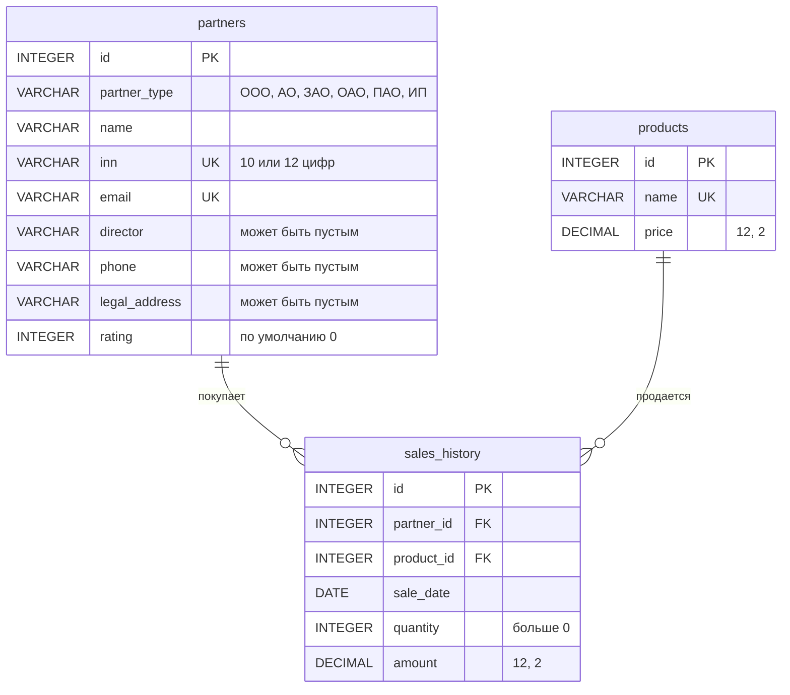

# Инфраструктура данных и ETL (База данных в 3NF)

Задание: заказчик передал «сырые» списки партнеров, продукции и истории
продаж со скрытыми аномалиями. Нужно спроектировать чистое хранилище в
третьей нормальной форме, написать DDL и импортировать данные с
очисткой.

## 1. Схема в 3NF



- **1НФ** — все значения атомарные. В исходном файле
  `ООО "Вектор"` — это два факта сразу: форма собственности и название.
  В базе они лежат в разных столбцах, `partner_type` и `name`.
- **2НФ** — у каждой таблицы простой первичный ключ `id`, частичных
  зависимостей нет.
- **3НФ** — нет транзитивных зависимостей: название и цена товара
  хранятся только в `products`, данные партнера — только в `partners`, а
  продажа ссылается на них по внешним ключам.
- `sales_history.amount` — не избыточная копия цены: это сумма сделки,
  которая со скидкой партнера может отличаться от `price × quantity`.
  В исходных данных все суммы с ценой совпали, это проверяют ETL и
  `import_check.sql`.

## 2. DDL — `schema.sql`

- **Ссылочная целостность:** `sales_history.partner_id` и `product_id` —
  `FOREIGN KEY` с `ON DELETE RESTRICT`. Партнера с продажами удалить
  нельзя, иначе его история повисла бы без владельца.
- **`NOT NULL`** — у всего, что пришло в файлах и обязательно по смыслу.
  Директор, телефон и адрес партнера в исходных данных отсутствуют,
  поэтому они необязательны: менеджер заполнит их в карточке.
- **`UNIQUE`** — ИНН и email партнера, название товара.
- **`DECIMAL(12, 2)`** — цена и сумма продажи: во float деньги считаются
  с погрешностью.
- **`CHECK`** — форма собственности из закрытого списка, ИНН из 10 или
  12 цифр, email похож на адрес, количество больше 0, цена, сумма и
  рейтинг не меньше 0.
- **Единый стиль имен** — `snake_case`. Ограничения названы явно
  (`partners_inn_uk`, `sales_history_partner_fk`), поэтому по ошибке
  СУБД сразу видно, какое правило нарушено.

Скрипт начинается с `DROP TABLE IF EXISTS` в обратном порядке
зависимостей, его можно запускать повторно.

## 3. Импорт и очистка — `etl.py`

ETL написан на Python: модуль `csv` надежнее читает «грязный» CSV, чем
`COPY`. Скрипт читает `data/*_raw.csv`, очищает данные и пишет
результат в `data/clean_*.csv`, которые `import.sql` загружает через
`\copy`.

| Аномалия в файлах | Где | Что сделано |
| --- | --- | --- |
| пробелы по краям и двойные пробелы (`" ООО ""Вектор"" "`, `petrov@yandex.ru `, `Петров  A.B.`) | названия, email, даты | `TRIM` и схлопывание пробелов |
| форма собственности слита с названием | все партнеры | разделена на `partner_type` и `name`, кавычки по краям названия убраны |
| «...» перед фамилией (`ИП ...Петров`) | партнер 2 | лишние точки удалены |
| инициалы латиницей (`A.B.` вместо `А.В.`) | партнер 2 | латинские буквы-двойники в инициалах заменены русскими, иначе поиск по «Петров А.В.» не нашел бы партнера |
| email с заглавными буквами | — | приводится к нижнему регистру: регистр в адресе не важен |
| шесть форматов дат: `25.10.2023`, `2023/10/26`, `2023-10-27`, `28-10-2023`, `2023.10.29`, ` 2023-10-30 ` | история продаж | все приведены к формату СУБД `ГГГГ-ММ-ДД` |
| продажа 1003 ссылается на партнера 999, которого нет | история продаж | строка отклонена и записана в `data/rejected_rows.csv` |
| `products_raw.csv` в кодировке Windows-1251, остальные — в UTF-8 | продукция | кодировка определяется автоматически |
| кавычка внутри значения без экранирования: `Монитор 27"` | продукция | `csv` читает ее как часть текста, в чистом файле она экранирована |

Последние две аномалии в условии не названы, но без обработки сырой
файл не загрузить. На настоящем PostgreSQL 18 это видно сразу:

```
\copy raw_products FROM 'data/products_raw.csv' WITH (FORMAT csv, HEADER true)
ERROR:  invalid byte sequence for encoding "UTF8": 0xcd 0xee

\copy raw_products FROM 'data/products_raw.csv' WITH (FORMAT csv, HEADER true, ENCODING 'WIN1251')
ERROR:  unterminated CSV quoted field
КОНТЕКСТ:  COPY raw_products, line 5: "103,Монитор 27",18200.0"
```

Каждое исправление записывается в `data/cleaning_log.csv`: файл,
строка, поле, значение до и после. Битые строки с причиной —
в `data/rejected_rows.csv`. Внешний ключ проверяется еще до загрузки:
иначе одна строка с партнером 999 сорвала бы `\copy` всего файла.

### Результат `python etl.py`

```
partners_raw.csv: кодировка utf-8, строк 5, загружено 5, отклонено 0
products_raw.csv: кодировка cp1251, строк 3, загружено 3, отклонено 0
sales_history_raw.csv: кодировка utf-8, строк 6, загружено 5, отклонено 1
Исправлено значений: 15 (подробно — data/cleaning_log.csv)
Отклонено: sales_history_raw.csv, строка 4: партнер 999 не найден
Суммы всех продаж совпадают с ценой × количество.
```

В число исправлений входит и разделение формы собственности с
названием у всех пяти партнеров.

| `clean_partners.csv` | | | | |
| --- | --- | --- | --- | --- |
| 1 | ООО | Вектор | 7701234567 | vector@mail.ru |
| 2 | ИП | Петров А.В. | 7802345678 | petrov@yandex.ru |
| 3 | АО | Технолоджис | 5003456789 | info@techno.ru |
| 4 | ООО | Альфа | 7704567890 | alpha@gmail.com |
| 5 | ИП | Сидоров И.И. | 7805678901 | sidorov@llc.ru |

## Запуск

```
psql -U postgres -c "CREATE DATABASE partners_db"
python etl.py
psql -U postgres -d partners_db -f schema.sql
psql -U postgres -d partners_db -f import.sql
psql -U postgres -d partners_db -f import_check.sql
```

Команды выполняются из папки задания: пути в `\copy` относительные. На
Windows перед `psql` стоит задать кодировку, иначе русский текст
читается неверно:

```
set PGCLIENTENCODING=UTF8
```

После импорта счетчики `id` сдвигаются на максимальный номер из файлов
(`setval`). Иначе первый партнер, добавленный из приложения, получил бы
занятый `id = 1`.

## Проверка на PostgreSQL 18

Скрипты прогнаны на чистой базе PostgreSQL 18.4. `import.sql`
загрузил `COPY 5`, `COPY 3`, `COPY 5`, а `import_check.sql` показал:

- строк: партнеров 5, товаров 3, продаж 5;
- значений с лишними пробелами — 0 (`value <> TRIM(value)` и двойные
  пробелы);
- все даты продаж в формате `ГГГГ-ММ-ДД`: 2023-10-25 … 2023-10-30;
- продаж со ссылкой на несуществующего партнера или товар — 0;
- продаж, где сумма не равна цене × количество, — 0.

Ограничения тоже проверены вставкой заведомо плохих строк: повтор ИНН
отклоняет `partners_inn_uk`, повтор email — `partners_email_uk`, форму
«ТОО» — `partners_type_ck`, ИНН из пяти цифр — `partners_inn_ck`, продажу
партнеру 999 — `sales_history_partner_fk`.

## Файлы

| Файл | Назначение |
| --- | --- |
| `schema.sql` | DDL: таблицы, ключи и ограничения |
| `etl.py` | очистка сырых файлов |
| `import.sql` | загрузка очищенных данных и сдвиг счетчиков |
| `import_check.sql` | проверочные запросы после импорта |
| `data/*_raw.csv` | исходные файлы заказчика без изменений |
| `data/clean_*.csv` | очищенные данные для импорта |
| `data/cleaning_log.csv` | журнал исправлений |
| `data/rejected_rows.csv` | отклоненные строки с причиной |
| `test_etl.py` | тесты очистки |

## Тесты

```
python -m unittest -v
```

23 теста: пробелы, разделение формы собственности, лишние точки и
латиница в инициалах (но не в «Pro Market»), email, ИНН, все шесть
форматов дат и невозможная дата 31.02, деньги в `Decimal`, количество и
id, определение кодировки Windows-1251 с кавычкой внутри значения,
повтор ИНН. Есть и полный прогон на настоящих файлах заказчика во
временной папке: проверяются итоговые таблицы, отклоненная строка,
даты, суммы и журнал исправлений.
