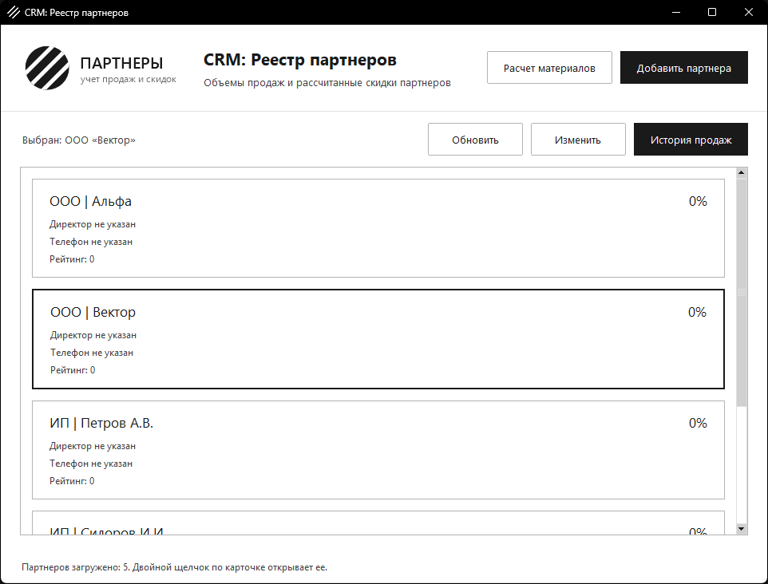
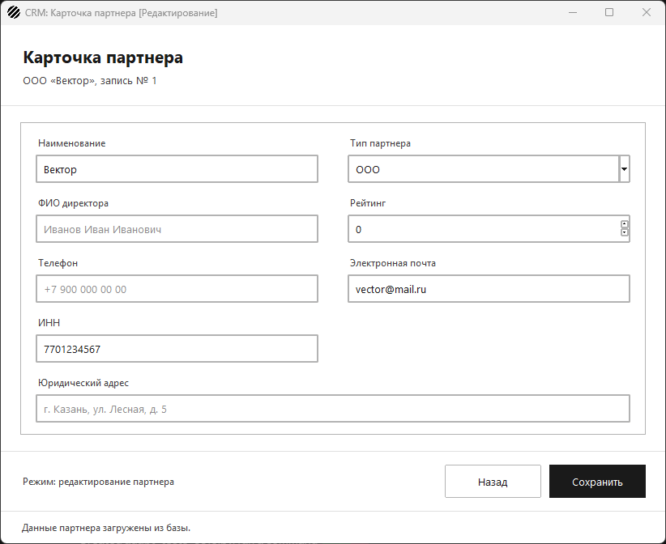
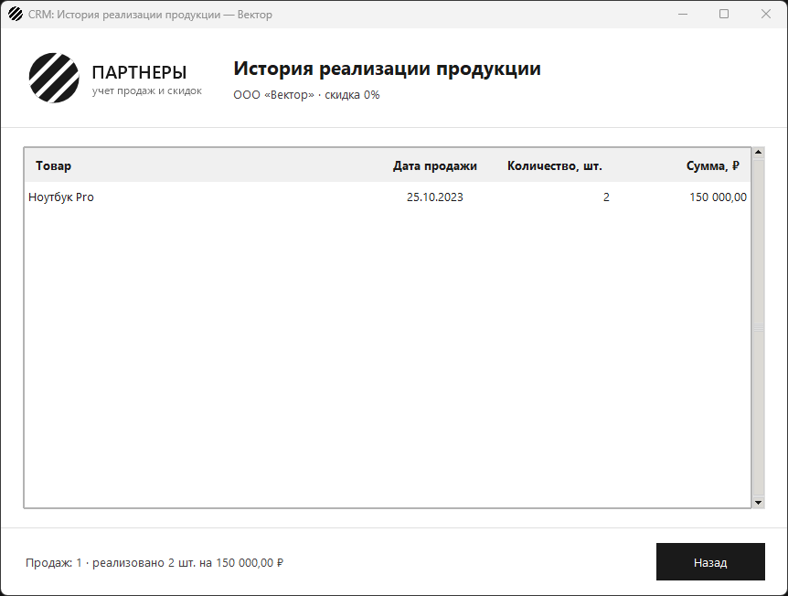
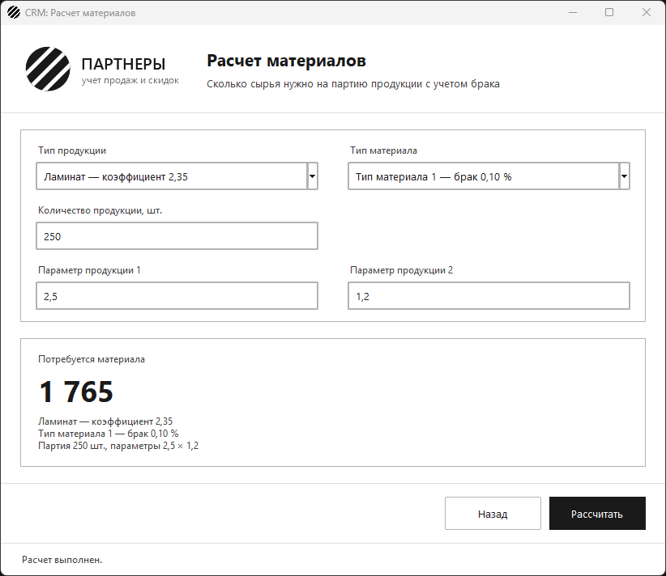

# Разработка UI, навигации и CRUD-форм

Задание: обернуть бизнес-логику и данные в интерфейс по требованиям
эргономики и руководству по стилю компании — главная форма, карточка
партнера, история продаж, переходы между окнами и синхронизация с базой.

База — та, что собрана в задании «Инфраструктура данных и ETL»: пять
партнеров, три товара и пять продаж из файлов заказчика. Все скриншоты
ниже сняты с настоящей базы PostgreSQL 18, без подмены данных.

## 1. Главная форма — `MainWindow`

Заголовок окна `CRM: Реестр партнеров`, иконка приложения в углу окна и
логотип компании в шапке — из папки `resources`. Список партнеров
загружается из базы карточками по руководству по стилю: тип и название,
директор, телефон, рейтинг и рассчитанная скидка. У партнеров из файлов
заказчика директора и телефона нет — карточка так и пишет: «Директор не
указан».

Щелчок выбирает партнера, двойной щелчок открывает его карточку.
Кнопки «Изменить» и «История продаж» работают с выбранным партнером,
«Добавить партнера» открывает пустую карточку, «Расчет материалов» —
калькулятор сырья.



## 2. Форма редактирования — `PartnerEditWindow`

| Поле | Виджет |
| --- | --- |
| Наименование | текстовое поле с подсказкой |
| Тип | выпадающий список `ttk.Combobox` только для выбора: ООО, АО, ЗАО, ОАО, ПАО, ИП — тот же список, что в ограничении `partners_type_ck` базы |
| Рейтинг | счетчик от 0; при сохранении проверяется, что это целое неотрицательное число |
| Адрес | текстовое поле с подсказкой |
| Директор | текстовое поле с подсказкой |
| Телефон | плейсхолдер `+7 900 000 00 00` и всплывающая подсказка формата |
| Email | плейсхолдер `partner@example.com` и всплывающая подсказка формата |
| ИНН | плейсхолдер `10 или 12 цифр` — обязателен в базе |

Обязательны, как и в базе, наименование, ИНН и email. Пустые директор,
телефон и адрес уходят в базу как `NULL`, а не как пустая строка. Почта
приводится к нижнему регистру, как при импорте: иначе `UNIQUE` счел бы
`Alpha@Gmail.com` и `alpha@gmail.com` разными адресами.

Заголовок окна показывает режим: `CRM: Карточка партнера [Добавление]`
или `[Редактирование]`.



## 3. Форма истории — `PartnerHistoryWindow`

Таблица продаж выбранного партнера: товар, дата продажи, количество и
сумма. Запрос идет с `JOIN` к справочнику товаров, а из реестра в окно
передается только `id` партнера. Внизу — итог: число продаж, сколько
штук продано и на какую сумму.



## Навигация без потери контекста

Все окна открываются через `Navigator`: реестр на это время прячется,
но не пересоздается. «Назад», крестик окна и Esc возвращают к нему с
тем же списком и тем же выбранным партнером. Если в карточке остались
несохраненные изменения, «Назад» сначала предупреждает об их потере.

## 4. Синхронизация с базой

«Сохранить» в карточке выполняет `INSERT` для нового партнера или
`UPDATE` по `id` для существующего. Карточка закрывается, а реестр
перечитывает базу, поэтому новый или измененный партнер сразу виден в
списке.

### Сквозная проверка на настоящей базе

Сценарий прошел через окна приложения на PostgreSQL 18:

1. Реестр загрузил 5 партнеров заказчика.
2. История «Вектора» показала `Ноутбук Pro · 25.10.2023 · 2 · 150 000,00`.
3. В карточке «Вектора» заполнены директор, телефон, адрес и рейтинг 8 →
   в базе `UPDATE`, реестр перечитан.
4. Добавлен партнер «Новый склад» с почтой `Sklad@Example.RU` → в базе
   новая строка с `id = 6` (счетчик продолжил номера из файлов),
   почтой `sklad@example.ru` и `NULL` вместо директора, в реестре 6
   партнеров.
5. Попытка сохранить партнера с уже существующим ИНН → карточка осталась
   открытой с сообщением «Партнер с таким ИНН уже есть в базе».
6. Расчет материалов по справочникам базы: 1 765.

**Найденная и исправленная ошибка.** На шаге 5 приложение сначала
показало «база данных недоступна»: любое исключение psycopg2 считалось
отказом связи. Теперь нарушение `UNIQUE` (`IntegrityError`) ловится
отдельно, а по имени ограничения из `error.diag` (`partners_inn_uk`,
`partners_email_uk`) менеджер видит, что именно повторилось. На
заглушках этот случай не проявлялся, нашелся только на настоящей базе.



## Файлы

| Файл | Назначение |
| --- | --- |
| `main_window.py` | `MainWindow` — реестр партнеров |
| `partner_edit_window.py` | `PartnerEditWindow` — добавление и редактирование |
| `partner_history_window.py` | `PartnerHistoryWindow` — история продаж |
| `material_calculator_window.py` | окно расчета материалов |
| `navigation.py` | переходы между окнами |
| `partner_cards.py`, `form_fields.py`, `ui_style.py`, `app_resources.py`, `resources/` | карточки списка, поля формы, стиль, логотип и иконка |
| `validation.py`, `dialogs.py`, `app_log.py` | проверка данных, диалоговые окна, журнал ошибок |
| `app.py` | запуск приложения |
| `partner_service.py`, `partner_discount.py`, `material_calculator.py`, `db.py` | ядро из прошлого задания |
| `schema.sql`, `etl.py`, `import.sql`, `import_check.sql`, `data/` | база и импорт данных заказчика |
| `test_*.py`, `app_test_base.py` | тесты |

## Запуск

```
pip install -r requirements.txt
psql -U postgres -c "CREATE DATABASE partners_db"
psql -U postgres -d partners_db -f schema.sql
psql -U postgres -d partners_db -f import.sql
python app.py
```

## Тесты

```
python -m unittest -v
```

159 тестов, из них 6 — на настоящей базе. Оконные тесты работают на
заглушке базы и проверяют переходы
и заголовки, поля формы и подсказки, сохранение (в том числе повтор
ИНН — сообщение не про недоступную базу), историю с четырьмя столбцами
и пропуском пустого директора, проверку данных (обязательные поля,
формат ИНН и почты, длина телефона, пустые поля как `NULL`), расчет
материалов и уведомления. Тесты из `test_database.py` ходят в настоящую
базу и пропускаются, если она недоступна.
